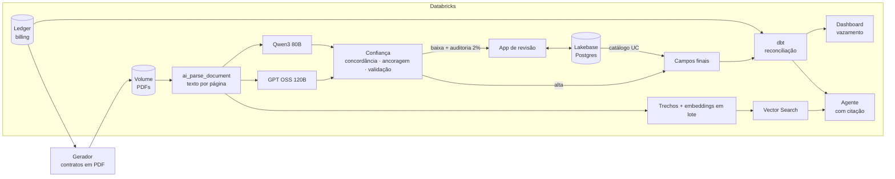

# Contrato Vivo

IA lendo contratos em PDF dentro do **Databricks** para encontrar **receita que a empresa tem direito de cobrar e não cobra**: extração com dois modelos e confiança verificável, revisão humana, reconciliação com o billing e um agente que responde perguntas sobre os contratos citando documento e página.

[](https://github.com/wallacx7/databricks-contract-intelligence/actions/workflows/ci.yml)


<!--  -->

## Em números

| | |
|---|---|
| Documentos lidos (contratos e aditivos, 14% digitalizados com ruído) | **651** documentos, 13.020 campos |
| Acerto da extração em documentos nunca usados nos ajustes | **99,99%** (9.100 campos) |
| Erros que passariam sem revisão humana | **0** (após a validação de identificadores, ADR 002) |
| Campos aceitos sem revisão humana | **98,8%** |
| Acerto medido pela auditoria por amostragem | **100%** (149 campos) |
| Vazamento encontrado vs. plantado | **idêntico**: 55 contratos, 1.336 contrato-meses, 4 tipos, zero falso positivo |
| Receita recuperável nos próximos 12 meses (cenário simulado) | **R$ 332 mil** |
| Agente: perguntas inéditas com valor e página citada corretos | **94,8%** (73 de 77); página certa em **97%** das citações |
| Custo de infraestrutura | **R$ 0**: Databricks Free Edition, modelos servidos no próprio workspace |

## O problema

Em contratos B2B, desconto de primeiro ano que nunca expira no sistema, reajuste que ninguém aplicou e cliente abaixo do compromisso mínimo sem pagar a diferença são comuns. Isso se chama **vazamento de receita**: o contrato dá direito a cobrar, o billing não cobra. Descobrir exige ler o contrato, e ninguém lê centenas de contratos todo mês.

O Contrato Vivo lê os contratos com IA, mede a própria confiança, manda para uma pessoa só o que precisa de olho humano, confronta o que foi lido com o billing e mostra quanto dinheiro está ficando na mesa, contrato a contrato.

Ele continua o universo do [**Ledger**](https://github.com/wallacx7/databricks-revenue-agent): os contratos são dos clientes da Nimbus e a reconciliação lê o billing do Ledger. Os dois projetos são produtos de dados que se consomem.

## Arquitetura



| Função | Tecnologia |
|---|---|
| Plataforma | Databricks Free Edition (serverless), Unity Catalog |
| Leitura de documentos | Auto Loader (binário), `ai_parse_document` (inclui OCR) |
| Extração | `ai_query` com JSON Schema estrito, GPT OSS 120B e Qwen3 80B servidos no workspace |
| Pipeline | Lakeflow Declarative Pipelines em PySpark (streaming tables e materialized views) |
| Revisão humana | Databricks Apps (Streamlit), Lakebase (Postgres) registrado no Unity Catalog |
| Reconciliação | dbt-databricks, testes contra o gabarito |
| Busca | Vector Search (busca híbrida) com embeddings calculados em lote |
| Agente | Tool calling com argumentos validados e SQL parametrizado, MLflow |
| Consumo | AI/BI Dashboard, App com perguntas |
| Deploy | Databricks Asset Bundles (inclui Lakebase, App, dashboard e jobs) |
| Qualidade | pytest (51 testes), ruff, `dbt parse`, GitHub Actions |

## Como funciona

### 1. Contratos realistas, com gabarito

O [gerador](src/contrato_vivo/gerador) lê o billing do Ledger e escreve, para cada cliente Mid-Market e Enterprise, o contrato e um aditivo por mudança de plano, em quatro modelos de redação (cláusulas numeradas, quadro resumo, texto corrido com valores por extenso, condições em anexo). Cerca de 14% saem **digitalizados**: imagem com rotação, ruído, manchas e compressão, sem camada de texto.

Quatro tipos de **vazamento são plantados em cláusulas**, não no billing: desconto promocional vencido, preço contratado acima do cobrado, reajuste anual fixo nunca aplicado e compromisso mínimo de usuários. Os contratos também têm iscas, como o "valor mensal estimado" ao lado do preço por usuário. O gerador grava o valor certo de cada campo e o vazamento mensal esperado, e um teste garante que **contratos sem vazamento plantado cobram exatamente o devido em todos os meses** ([ADR 001](docs/adr/001-arquitetura-e-dados.md)).

### 2. Leitura e extração com confiança verificável

Cada PDF é lido uma única vez (streaming table) por `ai_parse_document` e extraído por **dois modelos** com o mesmo JSON Schema. Um campo só tem **confiança alta** com três sinais independentes ([ADR 002](docs/adr/002-extracao-e-confianca.md)):

- **concordância:** os dois modelos chegam ao mesmo valor;
- **ancoragem:** números aparecem escritos no documento;
- **validação:** identificadores têm formato válido e são coerentes entre si.

O terceiro sinal nasceu de um erro real: o OCR leu "NIM-002362" como "M-002362" e **os dois modelos concordaram no erro**, porque leem o mesmo texto. Concordância protege contra erro de modelo, não contra erro de leitura.

| Conjunto (documentos nunca usados em ajustes) | Documentos | Acerto |
|---|---|---|
| Digitais | 380 | 100% |
| Digitalização leve | 39 | 100% |
| Digitalização média | 28 | 99,82% |
| Digitalização forte | 8 | 100% |

### 3. Revisão humana

A fila de revisão recebe os campos de confiança baixa e uma **amostra de auditoria de 2%** dos de confiança alta, que mede o acerto real sem gabarito. A [App](src/app.py) mostra a página do PDF ao lado do valor; as decisões vão para o **Lakebase** (Postgres), com reserva de item para revisores simultâneos, e voltam ao lakehouse pelo catálogo do Unity Catalog ([ADR 003](docs/adr/003-revisao-humana.md)).

### 4. Reconciliação com o billing

Modelos [dbt](dbt/) calculam, contrato a contrato e mês a mês, o documento vigente e o preço que o contrato manda cobrar (descontos, reajuste fixo ou de tabela, mínimo de usuários) e comparam com o billing do Ledger ([ADR 004](docs/adr/004-reconciliacao.md)).

| Tipo de vazamento | Contratos | Valor encontrado | Valor plantado |
|---|---|---|---|
| Mínimo não cobrado | 25 | R$ 1.426.932,11 | R$ 1.426.932,11 |
| Reajuste não aplicado | 11 | R$ 1.307.269,61 | R$ 1.307.263,91 |
| Desconto vencido | 14 | R$ 695.608,32 | R$ 695.608,32 |
| Preço abaixo do contratado | 5 | R$ 68.529,06 | R$ 68.529,06 |

Mesmos contratos e mesmos meses nos quatro tipos, sem falso positivo; a diferença de R$ 5,70 é arredondamento. Um teste dbt falha o job se isso deixar de valer.

### 5. Perguntas sobre os contratos

Cada cláusula vira um trecho indexado no **Vector Search**. O [agente](src/contrato_vivo/agente) localiza o contrato pelo nome do cliente, lê os termos vigentes (considerando aditivos), busca cláusulas e consulta o vazamento, e **cita documento e página** em cada fato ([ADR 005](docs/adr/005-agente-com-citacao.md)).

Os embeddings são calculados **em lote com `ai_query`** na tabela de origem: no modo gerenciado do índice, o Free Edition processava cerca de 30 trechos por minuto (mais de 4 horas para os 10.537 trechos); em lote, o índice completo ficou pronto em 3 minutos.

Avaliação com perguntas geradas do gabarito, conferindo o valor **e** a página citada:

| Categoria | Ajuste (70) | Controle (77, rodado uma vez) |
|---|---|---|
| Multa de rescisão | 100% | 100% |
| Preço vigente (considera aditivos) | 84% | 90% |
| Fim da vigência | 100% | 100% |
| Compromisso mínimo | 100% | 100% |
| Quanto deixou de faturar | 100% | 71% |
| Fora do escopo (precisa recusar) | 100% | 100% |
| **Total** | **95,7%** | **94,8%** |

As falhas do controle e o que as corrigiria estão no ADR 005: o agente informa só um dos vazamentos quando o contrato tem dois tipos, e às vezes pesquisa o nome do cliente pela metade e pede para o usuário escolher entre empresas parecidas.

## Em produção eu faria

- **Origem real:** contratos vindos do sistema de gestão de contratos (CLM) e do e-mail, com os mesmos sinais de confiança; o gabarito daria lugar à auditoria por amostragem, que já está pronta.
- **Revisão:** autenticação dos revisores pelo Databricks (on-behalf-of-user), metas de tempo de revisão e alertas quando a auditoria aprovar menos de 99%.
- **Ação sobre o vazamento:** integração com o billing para abrir a correção (ou a cobrança retroativa) com aprovação humana, nunca automática.
- **Custo:** extração com o segundo modelo só quando o primeiro tiver campos de risco (preço, desconto, reajuste), em vez de sempre.
- **Ambientes:** catálogos separados por ambiente e deploy de prod pelo CI com service principal.

## Limitações conhecidas

- Contratos de quatro modelos de redação e digitalização simulada; contratos reais seriam mais difíceis e o acerto, menor.
- A regra do preço devido existe no gerador e no dbt; o teste contra o gabarito garante que continuam iguais, mas contratos com várias causas de vazamento sobrepostas precisariam de decomposição.
- O modelo de embedding (`gte-large-en`) é otimizado para inglês; a busca usa filtro por contrato e busca híbrida para compensar.
- O agente erra quando o contrato tem dois tipos de vazamento e quando pesquisa o nome do cliente pela metade (ADR 005).

## Como rodar

Pré-requisitos: o [Ledger](https://github.com/wallacx7/databricks-revenue-agent) já rodando no mesmo workspace, Databricks CLI autenticado e Python 3.11.

```bash
python -m venv .venv && source .venv/bin/activate      # Windows: .venv\Scripts\activate
pip install -e ".[dev,dbt,agente]"
pytest

databricks vector-search-endpoints create-endpoint contrato-vivo STANDARD   # uma vez
databricks bundle deploy -t dev
databricks bundle run contrato_vivo_gerador -t dev --params limite=400
databricks bundle run contrato_vivo_diario -t dev
databricks bundle run contrato_vivo -t dev                                  # App de revisão e perguntas
```

A App roda com um service principal próprio (`databricks apps get contrato-vivo` → `service_principal_client_id`), que precisa de permissões executadas uma vez por quem administra o workspace:

```sql
-- Unity Catalog (editor SQL)
GRANT USE CATALOG ON CATALOG workspace TO `<app-sp>`;
GRANT USE SCHEMA, SELECT ON SCHEMA workspace.<schema_lc_silver> TO `<app-sp>`;
GRANT USE SCHEMA, SELECT ON SCHEMA workspace.<schema_lc_gold> TO `<app-sp>`;
GRANT USE SCHEMA, READ VOLUME ON SCHEMA workspace.<schema_lc_raw> TO `<app-sp>`;

-- Lakebase (editor de consultas da instância contrato-vivo, banco revisao)
GRANT USAGE ON SCHEMA revisao TO "<app-sp>";
GRANT SELECT, INSERT, UPDATE, DELETE ON ALL TABLES IN SCHEMA revisao TO "<app-sp>";
```

## Estrutura

```
├── databricks.yml                  # variáveis e targets
├── resources/                      # schemas, volumes, Lakebase, pipeline, jobs, App e dashboard
├── src/
│   ├── contrato_vivo/gerador/      # contratos em PDF, digitalização e gabarito
│   ├── pipelines/leitura/          # leitura, extração, confiança, fila de revisão, trechos
│   ├── contrato_vivo/revisao/      # banco da revisão (Lakebase) e revisor simulado
│   ├── contrato_vivo/agente/       # agente com citação e avaliação
│   ├── sql/                        # sincronização das revisões e tabela do índice
│   ├── dashboards/                 # AI/BI Dashboard
│   └── app.py                      # App: revisão e perguntas
├── dbt/                            # reconciliação com o billing e testes contra o gabarito
├── tests/unit/                     # 51 testes
└── docs/adr/                       # decisões de arquitetura
```

## Decisões de arquitetura

| ADR | Decisão |
|---|---|
| [001](docs/adr/001-arquitetura-e-dados.md) | Contratos gerados a partir do billing do Ledger, vazamento plantado em cláusulas |
| [002](docs/adr/002-extracao-e-confianca.md) | Extração com dois modelos e confiança por concordância, ancoragem e validação |
| [003](docs/adr/003-revisao-humana.md) | Revisão humana com Lakebase, reserva de itens e auditoria por amostragem |
| [004](docs/adr/004-reconciliacao.md) | Reconciliação dos contratos com o billing em dbt |
| [005](docs/adr/005-agente-com-citacao.md) | Agente com citação e embeddings em lote |

## Autor

Wallace Magalhães · [GitHub](https://github.com/wallacx7)
